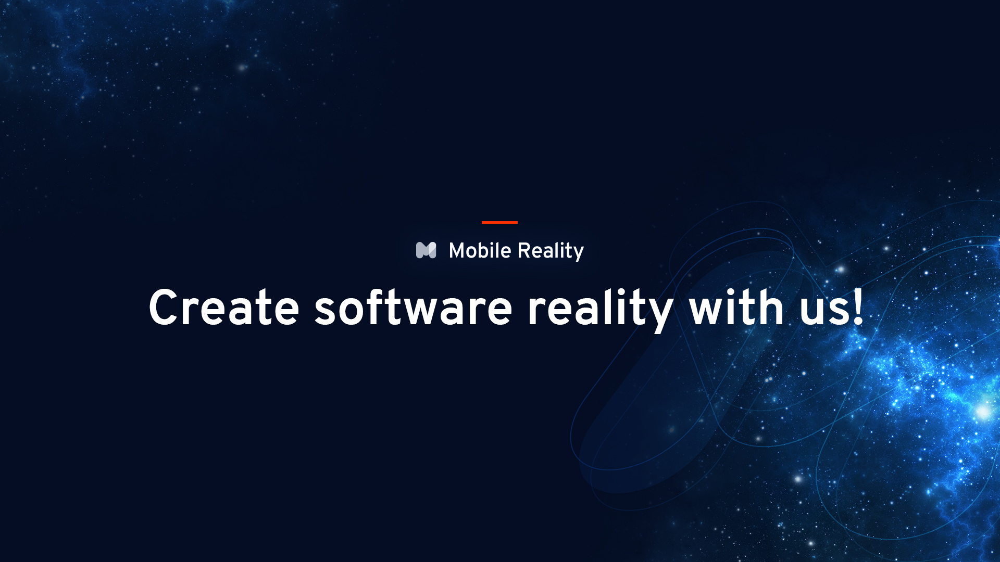

# Mobile Reality

**Business Change with AI Agents. Automate, Optimize, and Scale.**

We are an AI automation agency and end-to-end product software development company from Poland, building since 2016. We design intelligent systems, from AI agents and automation pipelines to full-stack digital products, with a highly AI-driven approach in core technologies (full-stack JavaScript, React, Node.js, AWS).

Official [make.com](https://www.make.com) Partner with 75+ production deployments. 100+ projects delivered, 5.0/5 on [Clutch](https://clutch.co/profile/mobile-reality).

## AI and agents

* [MDMA](https://github.com/MobileReality/mdma) — open-source generative UI engine. Your LLM answers with interactive components (forms, tables, approval gates, charts, webhooks) instead of plain text. Ships with an MCP server and an Agent Skill, deterministic Markdown + YAML parsing, and 98% reliability across GPT, Claude, Gemini, and Llama.
* [Mobile Reality Skills](https://github.com/MobileReality/mobile-reality-skills) — distributable agent skills for the team, for Claude Code and Codex on Windows, macOS, and Ubuntu. Install via `npx skills`.

## Libraries and tools

* [React Native Select Pro](https://github.com/MobileReality/react-native-select-pro) — React Native dropdown (select) component. 300+ stars.
* [ESLint Config](https://github.com/MobileReality/eslint-config) — our shared ESLint and Prettier configuration for React, React Native, and TypeScript.
* [Gatsby GDPR Cookies Plugin](https://github.com/MobileReality/gatsby-plugin-gdpr-cookies) — add Google Analytics (V4), Google Tag Manager, Facebook Pixel, TikTok Pixel, HubSpot, and Hotjar to your Gatsby site in a GDPR-compliant way.
* [NestJS Outbox](https://github.com/MobileReality/nestjs-outbox) — transactional outbox pattern for NestJS.
* [React Native MSAL Module](https://github.com/MobileReality/react-native-msal-module) — Microsoft Authentication Library module for React Native.

## Boilerplates

* [SPA React](https://github.com/MobileReality/spa-react)
* [REST NestJS](https://github.com/MobileReality/nestjs-rest)

## Smart contracts

* [NFT Reality](https://github.com/MobileReality/nft-reality-contracts)

----

Have a question? Email us at [hello@themobilereality.com](mailto:hello@themobilereality.com).

Check our team and work at [themobilereality.com](https://themobilereality.com).
